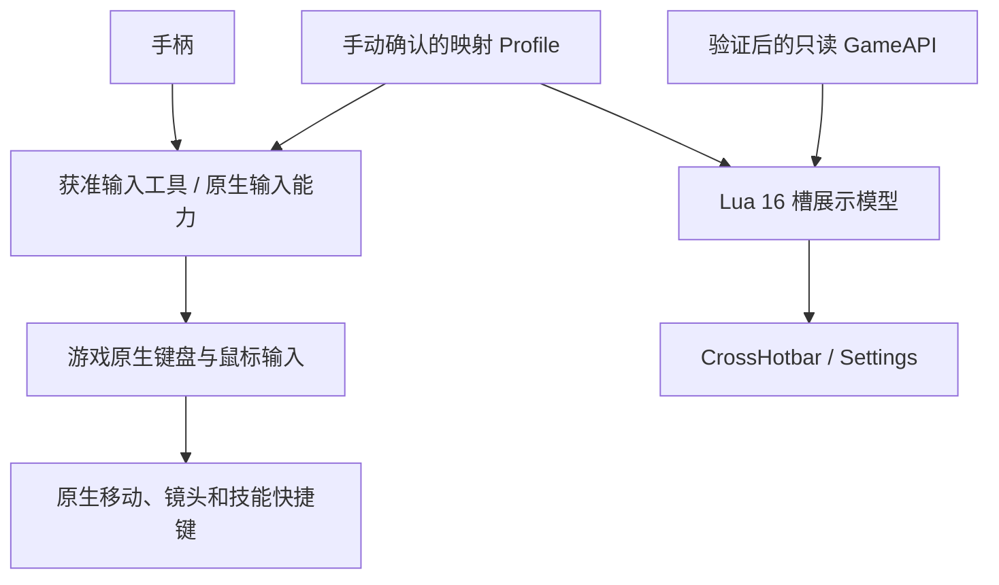

# 核心功能、技术方案与实施计划

日期：2026-11-02；设计基线 v0.1，本轮执行修订 1。

## 核心功能与验收边界

| 功能 | 第一版行为 | 验收 |
|---|---|---|
| 基础输入 | 左摇杆数字 WASD、右摇杆相对鼠标、A 跳跃 | 同时操作可用；松杆/失焦/断连无残留 |
| 双技能层 | RT 8 槽、LT 8 槽；层覆盖基础面键/方向键 | 按键先后和释放顺序均无串键或双触发 |
| CrossHotbar | 同时显示 RT/LT 各 8 槽，名称、按钮、游戏键位 | 与实际映射逐槽一致 |
| 配置 | 单角色/单设备/一套 Profile；HUD 可隐藏、移动、缩放 | 非法配置有默认值；键鼠可继续使用 |
| 可选数据 | 已验证接口提供图标/冷却/层状态 | 缺失时静态双层、文字/占位、不显示假冷却 |
| 诊断 | 入口版本、能力存在性、注册状态、原始回调计数 | 失败可定位；不把调用成功写成实测通过 |

RingMenu、TargetHUD、轻功专用模式、PlayStation 图标及多门派 Profile 后置。P0 不实现 LT+RT 第三技能层；两扳机同时按住时不应产生新技能输入，已有按键必须仍能正常释放。这是待输入工具验证的验收要求，尚无已实现配置。

## 技术架构

此图的 Profile 是共同配置规格，不表示 Lua 与 Steam Input 存在 IPC。优先调查官方原生支持；当前具体输入候选为 Steam Input legacy keyboard/mouse。Valve 文档仅证明工具功能，不证明游戏对该方案的许可。

模块按验证进度引入，避免先写大量未经验证的游戏接口：

| 模块 | 职责 | 引入条件 |
|---|---|---|
| `Main` / `Logger` | 初始化、80 行内存日志、版本与错误状态 | 本轮 Main 已具备；日志输出函数仍待实机验证 |
| `GameAPI` | 把来源、权限、类型检查、调用错误和降级集中隔离 | 实机验证第一个允许接口时抽取 |
| `Profile` / `InputAdapter` | 槽位与逻辑按钮、游戏键位描述；不注入输入 | 输入方案确认后先做纯 Lua 数据模型 |
| `CrossHotbar` | 16 槽静态布局与手动配置 | 加载、允许 UI 入口及输入方案通过 |
| `Settings` | 可见性、布局、缩放、保存 | UI 与允许的保存接口通过；否则仅会话配置 |
| 技能数据适配 | 图标与冷却，只更新变化内容 | 对应只读 API 完成来源/存在/许可/行为验证 |

槽位最小规格：`slot_id`、`layer=RT|LT`、`button`、`game_key`、`display_name`、可选 `icon`。显示模型不提供施法函数。摇杆死区、镜头灵敏度和层切换由输入工具控制；Lua 只记录说明。

## 输入决策

沿用已有候选：RT 输出 `1..8`，LT 输出 `Ctrl+1..8`；A/X/Y/B 与方向键上/左/右/下对应槽 1..8。游戏原生冲突表通过之前，这些都不是已生效键位。

基础 A→Space 必须在技能层被覆盖。必须测试：扳机先按、面键先按、先松扳机、先松面键、双扳机、聊天焦点、桌面切换、覆盖层、断连重连。输入工具不能可靠释放或覆盖时，不进入 HUD 联调。常用高频技能优先分配面键，方向键安排低频动作，后续按实机体验调整。

动态层高亮仅在层状态可可靠观察时开启。快捷键反馈不等于当前 RT/LT 状态，Steam Input 层切换也不必输出可供 Lua 观察的修饰键。

## 执行顺序与完成条件

| 顺序 | 工作与交付 | 当前状态 | 下一道验收 |
|---|---|---|---|
| S0 环境/来源 | 路径、版本、政策查询记录 | 本机路径与配置版本已记录；官方测试许可未确认 | 获取适用规则证据，不将“继续测试”写成官方认证 |
| S1a 离线探针 | 容错、语法、模拟 API、机器可读证据 | 已通过 Lua 5.1/5.4，每版 13 项回归及冒烟 | 当前探针与暂存副本哈希相符 |
| S1b 实机加载 | 管理器识别、入口、Debug Ping、down/up | 已暂存默认禁用探针；应用控制工具启动失败 | 一次按下/抬起各增加 1，重复 3 次各为 3 |
| S2 输入原型 | 单设备完整键位表、冲突表、焦点/断连记录 | 未开始；设备待提供 | 基础输入和全部 16 槽无串键与残留 |
| S3 静态 HUD | Profile、16 槽、设置和会话降级 | 未开始 | 逐槽核对映射；显示/隐藏不影响输入 |
| S4 可选数据 | 图标、冷却与刷新策略 | 未开始 | 与原生界面一致；接口缺失可降级 |
| S5 稳定性 | 30 分钟体验、共存/重载/UI 比例测试 | 未开始 | 无持续错误、明显卡顿或输入残留 |

S1b 的当前障碍是工具环境，不是已证实的游戏认证拒绝：没有观察到客户端管理器，不应推断其接受或拒绝。

原设计单人工作量：S0 1–3 天，S1 3–5 天，S2 3–7 天，S3 5–10 天，S4 3–7 天，S5 3–5 天；依赖验证结果，排除外部等待。先验收 S1b/S2 再确认后续排期。

## 本轮技术修正

- 命名空间为数值或索引抛错时降级，避免入口崩溃。
- `Hotkey.AddBinding` 抛错、明确返回 false、未抛错分别记录；后者为 `call_ok_unverified`。
- 同一 Lua VM 重复 `Start` 或执行入口不重复注册。要升级已加载代码，应走客户端正常 UI 重载/重启流程，不靠重复执行文件覆盖状态。
- 保留原始回调计数，重复回调不会被去重掩盖；最多保存 80 条内存日志。
- Logger 抛错或返回 false 时尝试备用渠道，均失败则保留内存记录；内存记录不等于可见调试信息。

## 变更与回滚

源目录是唯一编辑入口。部署只涉及 `interface/JX3CP_P0` 下的 `info.ini` 与 `Main.lua`，不修改 MY、用户配置、客户端执行文件或安全设置。本次目标目录原本不存在，未覆盖任何现有插件；未做全量配置备份，后续改绑定前另行备份相关配置。

关闭客户端后可移除本次独立探针目录；若客户端另有插件保存数据，先识别其归属再处理。版本、输入映射、API、加载方法一旦变化，重新执行对应验收。禁止把离线结果填入实机通过栏。

参考：[Valve legacy bindings](https://partner.steamgames.com/doc/features/steam_controller/legacy_mode)、[MY 快捷键源码](https://github.com/tinymins/JX3MY/blob/master/MY_%21Base/src/lib/System.Hotkey.lua)。
